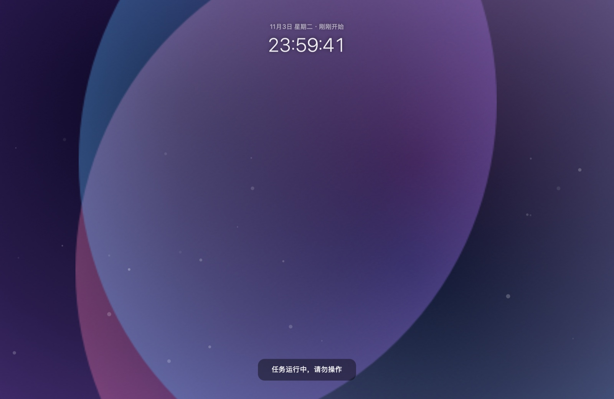

<div align="center">

# SakuraVeil 樱幕

**macOS 菜单栏防休眠工具 —— 一键保持清醒跑通宵，可选隐私幕布护屏**
**A macOS menu-bar stay-awake tool — one keystroke keeps your Mac running all night, with an optional privacy curtain.**




**[中文](#中文) | [English](#english)**

</div>

---

## 中文

跑任务时人要离开：不想锁屏（任务要继续跑），又不想屏幕被别人看到。
**SakuraVeil** 常驻菜单栏，按一下快捷键，屏幕瞬间变成动画 / 视频 / 壁纸 + 轮播文案，
任务在幕后照常运行 —— 只有你的全局快捷键或密码能解开。

### ✨ 功能

- **防休眠为主**：菜单栏图标即状态 —— 未开启显示 moon.zzz（会睡），开启后变 ⚡（不睡）；手动会话剩余时间直接显示在菜单栏（⚡ 59:12，可关）
- **保持唤醒会话**：默认时长可配置，到点动作可选睡眠 / 仅熄屏 / 通知；独立热键 `⌃⌥⌘W`
- **保持唤醒触发器**：指定 App 运行时 / 每日时间段 / 接通电源 / 外接显示器 → 自动防睡；「接通电源 + 外接屏 + 防系统睡眠」即合盖运行
- **遮屏（可选）**：隐私幕布是可选项 —— 菜单「立即遮屏」或热键 `⌃⌥⌘S` 手动触发，也可设置成遮屏时自动防睡
- **四种内容**：内置极光动画（纯 Core Animation，零素材）/ 自选视频（循环、静音）/ 自选图片 / 当前桌面壁纸
- **轮播文案**：底部胶囊每 8 秒轮换一句，支持自定义；顶部显示时钟与已遮屏时长
- **密码解锁**：遮屏时按任意键唤出；密码只存 Keychain，连错 5 次锁定密码输入 30 秒（快捷键不受影响）
- **全场景覆盖**：每块屏幕一块幕布，切 Space / 原生全屏 App 上方都盖得住
  （`canJoinAllSpaces` + `fullScreenAuxiliary` + `.screenSaver` 窗口层级）
- **接管输入**：幕布吞掉键鼠，不漏给底层 App；焦点被抢（如他人按 ⌘Tab）自动夺回
- **省心细节**：合盖唤醒 / 拔插显示器 / 改分辨率后自动恢复压盖；可选遮屏期间保持亮屏；开机自启；菜单栏 / 设置 / 幕布全部中英双语

### 🔧 构建

> 不想编译？直接从 [Releases](https://github.com/yueseqaz/SakuraVeil/releases/latest) 下载双架构 DMG / ZIP
> （push tag 后由 GitHub Actions 自动编译发布）。

```bash
./build.sh                        # 编译 arm64 并打包 SakuraVeil.app
MAKE_DMG=1 ./build.sh             # 额外生成 DMG
ARCHS="arm64 x86_64" ./build.sh   # 双架构（lipo 合并）
open SakuraVeil.app
```

纯 `swiftc` 命令行编译，不建 Xcode 工程；零第三方依赖；部署目标 macOS 13。

> 每次重新构建后首次启动，macOS 可能弹一次「想访问文件夹」的授权询问
> （ad-hoc 签名身份变化导致，与 app 功能无关），点一次即可，同一构建不会再弹。

### 📖 使用

启动后只有菜单栏一枚眼睛图标：

| 菜单项 | 说明 |
|---|---|
| 立即遮屏（`⌃⌥⌘S`） | 一键遮屏 / 再按解除 |
| 设置…（`⌘,`） | 打开设置窗口（见下） |
| 关于 SakuraVeil | 版本与项目主页链接 |
| 退出 SakuraVeil（`⌘Q`） | — |

**设置窗口**分三页：

- **通用**：遮屏内容模式、遮屏期间保持亮屏、开机自启、自定义轮播文案（每行一句，清空恢复默认）
- **安全**：修改全局快捷键（按下即录制的录制器）、设置 / 修改 / 清除解锁密码
- **关于**：版本信息、GitHub 仓库链接

### 🔓 退出机制

- **快捷键**：随时按 `⌃⌥⌘S`（或自定义组合）直接解除
- **密码**：遮屏时按任意键 / 点一下 → 浮出密码卡片 → 输对即解锁

### ⚠️ 诚实的限制

这是「视觉遮罩」，不是安全边界：

- Mission Control（F3）过渡瞬间可能闪出底下内容
- 通知中心（左滑）、Spotlight（`⌘空格`）浮层级更高，可以被呼出
- 屏幕共享 / VNC 完全绕过视觉遮罩

对"路过的人瞟一眼"的核心场景足够；要绝对安全请配合系统锁屏（`⌃⌘Q`）。

### 🗂 代码结构

```
SakuraVeil/
├── build.sh                        # swiftc 编译 + .app 组装 + 图标 + ad-hoc 签名
├── assets/                         # README 截图
└── Sources/
    ├── main.swift                  # 入口（accessory 菜单栏应用）
    ├── AppDelegate.swift           # 菜单栏 + 精简菜单
    ├── SettingsWindowController.swift   # 设置窗口（通用/安全/关于 三个标签页）
    ├── GeneralSettingsViewController.swift
    ├── SecuritySettingsViewController.swift
    ├── AboutViewController.swift
    ├── CoverController.swift       # 遮罩状态机 + 多屏窗口编排 + 唤醒/显示器监听
    ├── CoverWindow.swift           # 全屏遮罩窗口（screenSaver 层级 / 所有 Space）
    ├── CoverContentController.swift # 内容引擎：背景 + 时钟 + 文案轮播
    ├── AuroraView.swift            # 内置极光动画（Core Animation）
    ├── PasswordPanel.swift         # 密码浮层 + 防暴力锁定
    ├── HotkeyCenter.swift          # Carbon RegisterEventHotKey + 快捷键录制数据
    ├── HotkeyRecorder.swift        # 快捷键录制浮窗
    ├── KeychainStore.swift         # 密码存取（Keychain）
    ├── LaunchAtLogin.swift         # SMAppService 开机自启
    ├── KeepAwake.swift             # IOPMAssertion 保持亮屏
    ├── Settings.swift              # UserDefaults 设置持久化
    ├── StatusBarIcon.swift         # 菜单栏图标
    ├── I18N.swift                  # 中英双语
    └── Log.swift                   # os.Logger
```

---

## English

When you have to step away while a task is running: you don't want to lock the screen
(the task must keep running), but you don't want strangers reading it either.
**SakuraVeil** lives in your menu bar — press the hotkey and the screen instantly becomes
an animation / video / wallpaper with rotating messages, while your task keeps running
behind the curtain. Only your global hotkey or password can lift it.

### ✨ Features

- **Stay awake first**: the menu bar icon IS the status — moon.zzz when sleeping is allowed, ⚡ while staying awake; remaining time shown right in the menu bar (⚡ 59:12, optional)
- **Stay-awake sessions**: configurable default duration, end-of-session action (sleep / display sleep / notify); dedicated hotkey `⌃⌥⌘W`
- **Stay-awake triggers**: while chosen apps run / daily time range / on AC power / external display connected → auto no-sleep; "AC power + external display + no sleep" gives clamshell mode
- **Cover (optional)**: the privacy curtain is an opt-in feature — trigger via "Cover Now" or `⌃⌥⌘S`; can also auto-prevent sleep while covered
- **Four content modes**: built-in aurora animation (pure Core Animation, zero assets) / custom video (looped, muted) / custom image / current desktop wallpaper
- **Rotating messages**: a capsule at the bottom swaps lines every 8 s (editable); clock + covered duration on top
- **Password unlock**: press any key while covered; the password lives only in your Keychain; 5 wrong attempts lock input for 30 s (hotkey unaffected)
- **Covers everything**: one curtain per display, above every Space and native fullscreen apps
  (`canJoinAllSpaces` + `fullScreenAuxiliary` + `.screenSaver` window level)
- **Input capture**: the curtain swallows mouse & keyboard so nothing leaks to apps underneath; stolen focus is reclaimed automatically
- **Quality of life**: re-covers after display sleep / monitor hot-plug / resolution changes; optional keep-display-awake; launch at login; fully localized (中文 / English)

### 🔧 Build

> Don't want to compile? Grab the universal DMG / ZIP from [Releases](https://github.com/yueseqaz/SakuraVeil/releases/latest)
> (built and published automatically by GitHub Actions on tag push).

```bash
./build.sh                        # compile arm64 and bundle SakuraVeil.app
MAKE_DMG=1 ./build.sh             # also build a DMG
ARCHS="arm64 x86_64" ./build.sh   # universal binary (lipo merge)
open SakuraVeil.app
```

Plain `swiftc` command-line build, no Xcode project; zero third-party dependencies; deployment target macOS 13.

> After every rebuild, macOS may ask once for "access to folder" on first launch
> (caused by the changing ad-hoc signing identity, not by the app). Allow it once; it won't ask again for that build.

### 📖 Usage

After launching, you get a single eye icon in the menu bar:

| Menu item | Description |
|---|---|
| Cover Now (`⌃⌥⌘S`) | Toggle the curtain |
| Settings… (`⌘,`) | Open the settings window (below) |
| About SakuraVeil | Version + project link |
| Quit SakuraVeil (`⌘Q`) | — |

**Settings window** has three tabs:

- **General**: cover content mode, keep-display-awake, launch at login, custom rotating messages (one per line; empty = defaults)
- **Security**: change the global hotkey (press-to-record), set / change / remove the unlock password
- **About**: version info and a link to this repository

### 🔓 Unlocking

- **Hotkey**: press `⌃⌥⌘S` (or your custom combo) anytime
- **Password**: press any key / click while covered → password card appears → enter to unlock

### ⚠️ Honest limitations

This is a **visual curtain**, not a security boundary:

- Mission Control (F3) may briefly reveal content during its transition
- Notification Center (swipe left) and Spotlight (`⌘Space`) float above the curtain
- Screen sharing / VNC bypasses it entirely

Perfect for the "someone walking past" scenario; for real security, use the system lock screen (`⌃⌘Q`).

---

<div align="center">

© 2026 Sakura · Made with `swiftc` and zero dependencies

</div>
